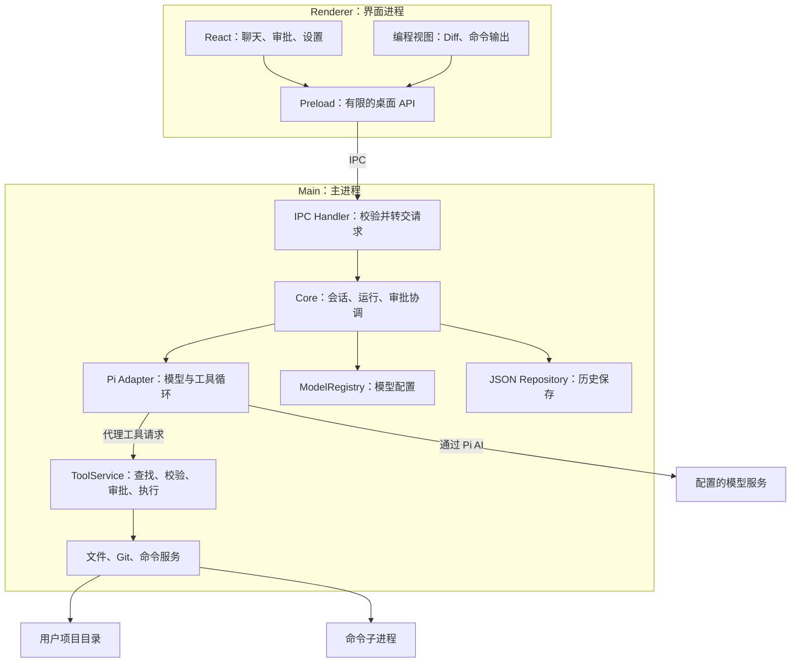
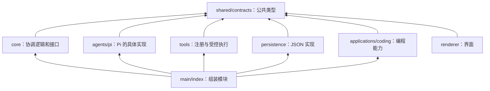
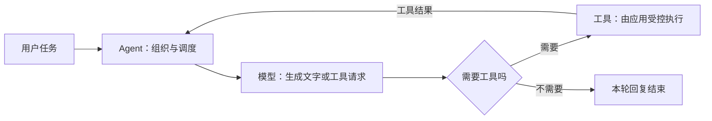
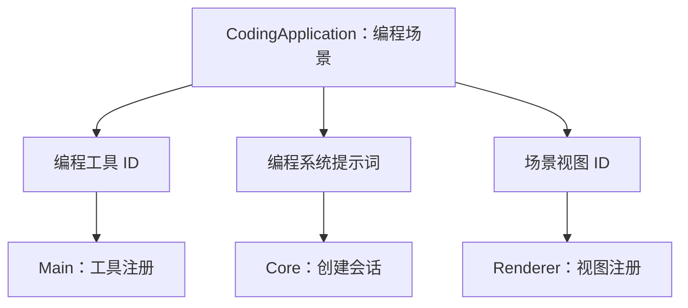
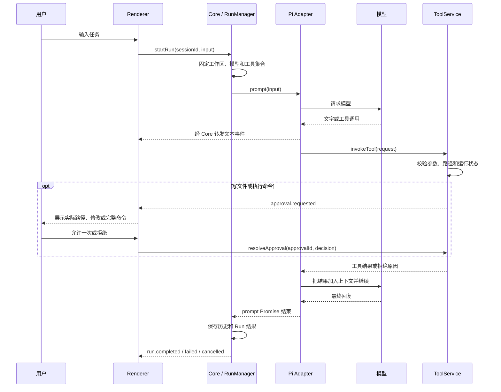
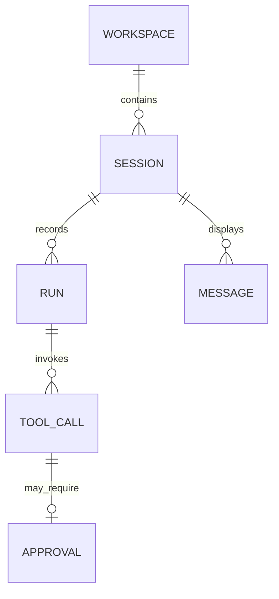
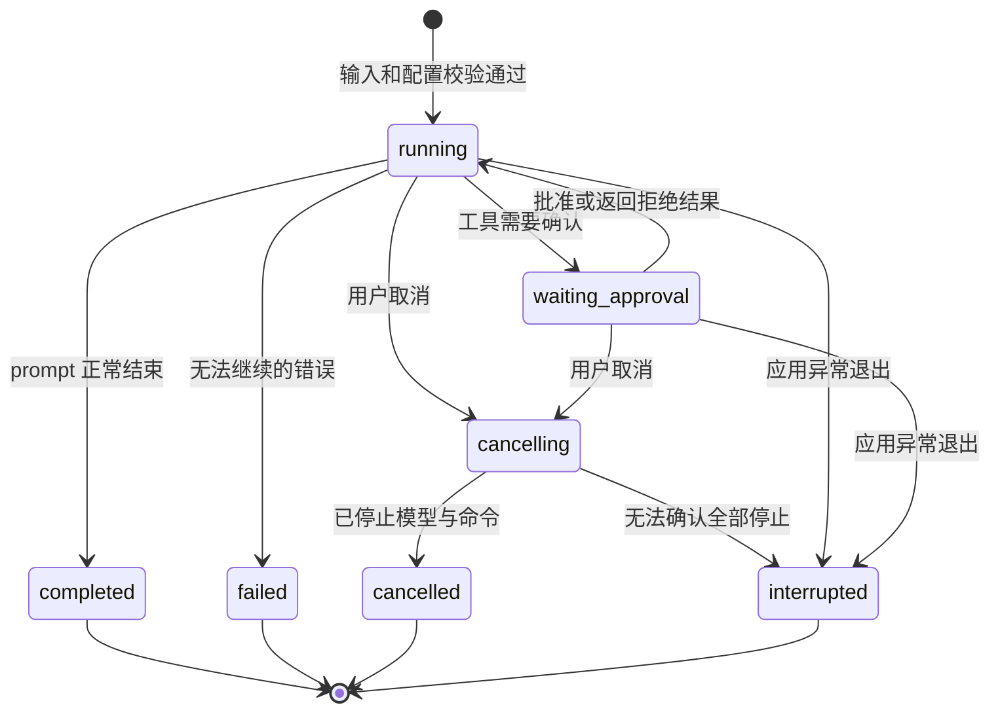
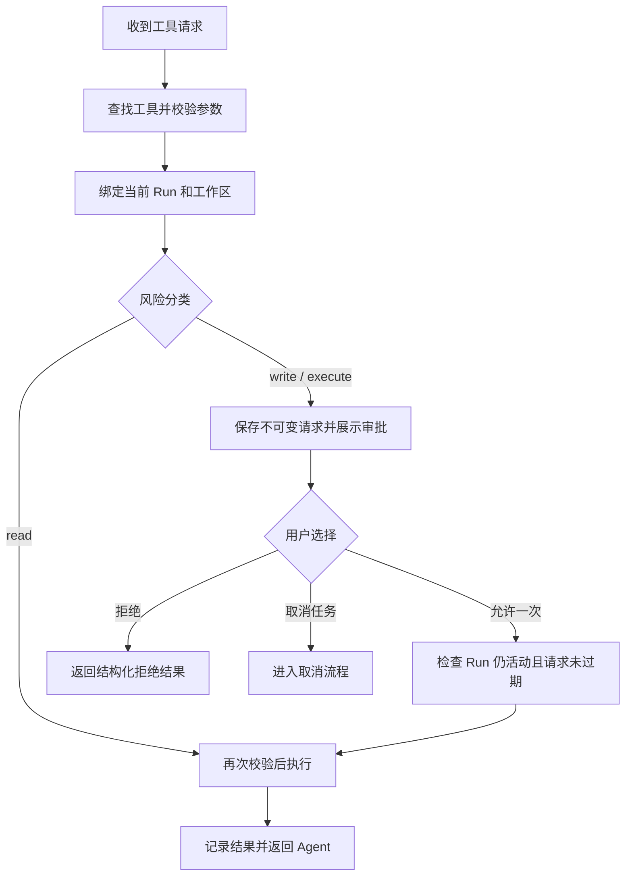
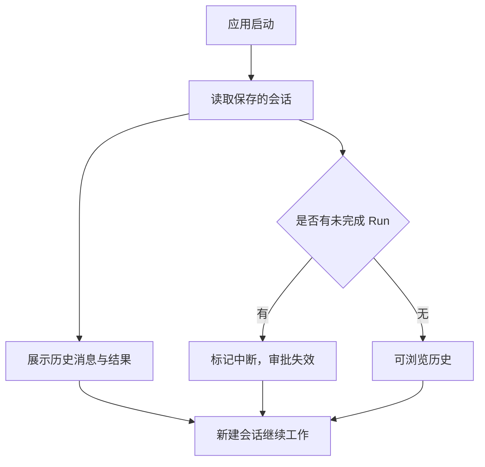
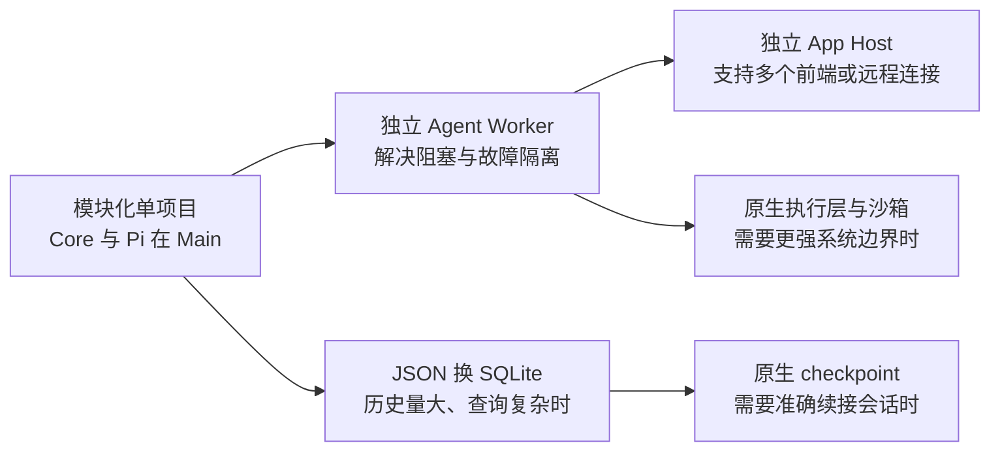

# Agent Desktop：学习版架构

> 先理解一个 Agent 怎样完成任务，再逐步把它做成桌面产品。

- 日期：2026-10-12。
- 状态：已按确认的简化方向更新；本文描述目标设计，产品代码尚未实现。
- 平台：Windows x64。
- 方法：从零实现，阅读 Pi 和 PI-Desktop 作为参考，不复制其产品代码。
- 目标：Agent 可替换、工具可注册、模型可自定义、应用可扩展；先做编程场景。

## 1. 怎样阅读这份文档

先读第 2～5 节，理解整体和四个扩展点；再读第 6～9 节，理解任务、审批和数据流。第一次阅读不必记住所有接口名称。

代码示例用于解释边界，是拟议的产品接口，不是 Pi SDK 的原有 API。尚未实现的类型会在对应章节解释，具体签名在实施时通过契约测试验证。

配套文档：

- [分阶段学习路线](../learning/01-roadmap.md)：每一步要理解什么、做出什么、怎样验收。
- [文档与注释约定](../guides/documentation-and-comments.md)：中文说明、示例、图和注释的写法。
- [术语表](../learning/02-glossary.md)：不熟悉的英文术语可从这里查起。

## 2. 产品目标与首版范围

### 2.1 四个目标分别解决什么问题

| 目标 | 具体含义 | 怎样验证 |
| --- | --- | --- |
| Agent 可替换 | Pi 是第一个实现，不是唯一实现 | 切换到 Mock Agent，UI 和工具服务不用重写 |
| 工具可注册 | 新工具通过定义和 Handler 接入 | 添加一个工具，不修改 Agent Loop |
| 模型可自定义 | 可配置兼容协议的 Endpoint、模型名称和凭据 | 换一个兼容模型，不修改 Core |
| 应用可扩展 | 编程工具和视图属于独立场景模块 | 添加演示应用，不把其业务写进 Core |

“应用”指编程、研究、数据分析等工作场景。“工具”指读取文件、执行命令等具体动作。“模型”和“Agent”的区别见第 5.1 节。

### 2.2 首版要完成的体验


首版可以帮助用户解释代码、修改文件和运行测试。测试本质上是一个受审批的命令，必须展示退出码和输出，不能仅凭 Agent 文字宣称通过。

第三方动态插件、多个 Agent 并行、远程执行、完整 IDE 和崩溃后自动继续任务不属于首版。扩展接口保留，相关基础设施以后按需要实现。

## 3. 简化的原则与技术选择

### 3.1 先分模块，再分进程

**模块边界**决定谁负责什么；**进程边界**决定这些模块在哪里运行。

首版把 Core 和 Pi 放在 Electron Main 内，通过函数接口通信。以后确有稳定性或并发需求，再把它们搬到独立进程。现在先不写 App Host、Agent Worker 或 stdio JSON-RPC。

Electron 实际还有 GPU、网络等内部进程。本文的“两部分”只指我们需要编写的 Main 与 Renderer；Preload 是 Renderer 侧的受限桥梁，不是第三个独立业务进程。

### 3.2 技术栈

| 部分 | 选择 | 学习上的理由 |
| --- | --- | --- |
| 桌面壳 | Electron | 可在一个 TypeScript 项目中学习桌面与 Node 能力 |
| 界面 | React + TypeScript + Vite | 界面、事件和类型容易追踪 |
| Agent | Pi Agent Core + Pi AI | 循环交给 Pi，重点学习适配、模型和工具桥接 |
| 工具输入校验 | JSON Schema + Ajv | 能在实际执行前验证模型生成的参数 |
| 数据 | JSON 文件 + Repository 接口 | 先观察保存内容，以后换 SQLite |
| 项目管理 | 单个 npm package，使用 pnpm | 不同时引入 monorepo、Rust 和多套构建系统 |
| 打包 | electron-builder，Windows NSIS | 核心闭环完成后再学习发布 |

UI 状态先使用 React state/context；组件复杂后再考虑状态库。首版不自己重写大模型协议或 Pi 的 Agent Loop。

## 4. 总体架构和依赖方向

### 4.1 谁在哪里运行



Main 中所有业务模块都使用异步操作；扫描文件、读写文件和命令执行不能用长时间同步调用阻塞主进程。Agent 模型调用等待网络时不会因此阻塞窗口，但大量 CPU 工作仍可能让 Main 无法响应，这也是以后拆进程的理由。

### 4.2 谁可以依赖谁



实际装配集中在 `main/index.ts`：创建服务、注册 Agent/工具/应用，把依赖传给 Core。Core 通过接口使用具体实现，不能 import Pi SDK、Electron、Git 工具或 JSON 文件存储实现。

CLI 将来用自己的入口组装同一套 Core，终端审批替代 GUI 审批。不要为 CLI 写一份循环，再为 Electron 写另一份。

## 5. 四个核心扩展点

### 5.1 Agent Adapter：替换决定下一步的引擎

模型根据上下文生成回复或工具调用；Agent 负责多轮调用、接收工具结果、组织上下文，直到本次任务结束。



Pi Adapter 把我们定义的接口转换成 Pi 的调用。Core 不需要知道 Pi 的事件名称或工具类型。

```typescript
interface AgentAdapter {
  id: string;
  supportedApiStyles: string[];
  createSession(config: AgentSessionConfig, bridge: AgentBridge): Promise<AgentSession>;
}

interface AgentSession {
  prompt(input: string): Promise<void>;
  abort(): Promise<void>;
  subscribe(listener: (event: AgentEvent) => void): () => void;
  dispose(): Promise<void>;
}

interface AgentBridge {
  invokeTool(request: ToolRequest): Promise<ToolResult>;
  getCredential(credentialRef: string): Promise<string | undefined>;
}
```

`AgentSessionConfig` 包含工作区、模型配置、系统提示词和可供模型选择的工具定义。`AgentBridge` 提供受控工具入口和凭据读取入口，不向 Adapter 传入完整 Core。

首版内置 `MockAgentAdapter` 和 `PiAgentAdapter`，两者都必须支持取消。`prompt()` 在本次运行真正结束后 resolve；失败 reject。RunManager 以这个 Promise 结算 Run，不能把 Pi 中任意一次 turn-end 都当作整个任务完成。

Pi 的工具 `execute` 是代理函数：必须 await `bridge.invokeTool()`。工具事件仅用于展示，不在事件监听器里再次执行工具。Pi SDK 的 import 和类型转换只放在 `agents/pi`。

首版只有新 Session 可以选择 Agent/模型；已有 Session 不进行跨 Agent 上下文迁移。切换配置创建新会话，避免边学接口边处理模型状态迁移。

### 5.2 Tool Registry：找到工具；ToolService：决定能否执行

Registry 像一本通讯录，保存工具定义和实现；ToolService 才是所有调用的门口。注册一个工具不代表它已经获得批准。

```typescript
interface ToolDefinition {
  id: string;
  description: string;
  inputSchema: JsonSchema;
  risk: "read" | "write" | "execute";
}

interface RegisteredTool {
  definition: ToolDefinition;
  execute(input: unknown, context: ToolContext): Promise<ToolResult>;
}
```

`ToolContext` 包含当前 Run 身份、固定的工作区、取消信号和所需服务。`ToolResult` 保存结构化结果和供模型阅读的文字；完整长输出保存为本地文件引用。

工具定义的 `risk` 来自受信任代码，不能由模型指定。相同工具 ID 重复注册直接报错。可向模型暴露的工具集合在 Run 开始时固定，调用时仍需单独审批。

工具 ID 采用 `coding.read_file` 这样的内部命名。部分模型协议对工具名字符有限制，Pi Adapter 将其转换成合法模型工具名，例如 `coding_read_file`，检查冲突并保存反向映射。协议细节不改变产品内部 ID。

首版 Agent 工具按顺序执行，便于跟踪日志和文件修改；以后再实现只读并行和写入锁。

### 5.3 Model Registry：配置模型服务

```typescript
interface ModelProfile {
  id: string;
  apiStyle: "openai-chat" | "openai-responses" | "anthropic-messages";
  endpoint: string;
  modelId: string;
  credentialRef?: string;
  supportsTools: boolean;
}
```

`id` 是应用内配置 ID，`modelId` 是服务器要求的模型名称，`apiStyle` 决定请求格式。ModelRegistry 管理配置；Pi Adapter 使用 Pi AI 把配置转换成真实请求。

首个真实 Provider 只实现 `openai-chat` 兼容接口。其它协议通过对应 Pi AI Provider 后续接入；类型中预留名称不代表首版已经实现。创建会话时检查 Adapter 是否支持所选 apiStyle，以及编码工具任务所需的工具调用能力。

自定义 URL 不能自动支持任意模型协议。连接测试由用户主动触发，失败要展示网络/认证/协议错误。使用远程模型时，必要的项目上下文会发送到该模型 Endpoint。

API Key 不直接保存在 `settings.json`。Electron 阶段由 Main 的 CredentialService 用 safeStorage 加密后存储；配置只保留 credentialRef。Renderer 不读取已保存的明文密钥，Adapter 只在请求时取得所需密钥；错误与日志中不能输出凭据。

CLI 学习阶段先从指定环境变量提供凭据，通过相同 `getCredential` 接口注入，不依赖 Electron，也不把环境变量值写进示例或版本库。切换到桌面入口只替换凭据服务实现，不修改 Core 或 Agent Loop。

### 5.4 Application Module：组合工作场景

编程应用负责组合工具、提示词和界面，不负责替换 Agent Loop 或自行授予权限。



首版使用小型 Manifest：`id`、`name`、`toolIds`、`systemPrompt`、`viewIds`。Main 注册工具 Handler，Renderer 注册同名的场景视图；通过 ID 关联。

**不要让 Main 注册 React 组件。** 两个进程不能直接共享组件实例：公共 Manifest 只包含可序列化声明，`applications/coding/main` 和 `renderer/applications/coding` 分别提供实现。

先用普通 Map 和构建时注册，不做动态插件发现、下载或任意脚本加载。未来可添加 `ResearchApplication`，共享会话和审批，只增加自己的工具和视图。

## 6. 任务从输入到结束的全过程

例子：用户提出“阅读 README，修复一个配置项，然后运行测试”。



图中的 A 到 R、R 到 C/T 都通过 Core 和 Preload/IPC；为了可读性省略中间转发线。UI 完全不调用工具 Handler。

循环的所有者是 Pi；RunManager 只负责生命周期、订阅、取消和保存。不能再在 RunManager 外面写一个“模型请求—工具执行”的重复循环。

## 7. 状态、审批与取消

### 7.1 三个容易混淆的对象



- Workspace：本地项目目录。
- Session：多次对话，固定工作区、应用、Agent 和模型。
- Run：处理一次用户输入，内部可以请求模型多次。
- ToolCall：Run 中的一次工具调用；Approval 只批准这一调用。

首版全应用同一时刻只运行一个 Run。正在运行时拒绝新的 startRun，并给出“请等待或取消”的明确状态；先不实现后台队列和 steering。

### 7.2 Run 状态图



`idle` 是 Session 没有活动 Run 的状态，不是 Run 状态。完成只代表 Agent 本次执行结束，任务是否达到目标仍要依据 Diff、命令退出码和验证证据判断。

### 7.3 工具审批流程



首版只支持允许一次、拒绝一次、取消任务。审批按 approvalId 查找 Main 保存的请求；Renderer 只能返回决定，不能在批准时偷偷更换路径、命令或工具参数。

取消时结束待审批 Promise，向 Agent 与 ToolContext 传播 AbortSignal，终止命令进程树。UI 显示“取消中”，收到停止确认后才显示“已取消”。重复批准或取消后批准都不能执行工具。

## 8. Electron 的安全桥梁与 UI 事件

### 8.1 Preload 只暴露少量方法

```typescript
interface DesktopApi {
  selectWorkspace(): Promise<WorkspaceSummary | null>;
  createSession(input: CreateSessionInput): Promise<SessionSummary>;
  startRun(input: StartRunInput): Promise<{ runId: string }>;
  cancelRun(runId: string): Promise<void>;
  resolveApproval(id: string, decision: "allow" | "deny"): Promise<void>;
  getSession(sessionId: string): Promise<SessionSnapshot>;
  onEvent(listener: (event: AppEvent) => void): () => void;
}
```

设置和历史列表方法按功能阶段添加。不要暴露 `invoke(anyChannel, anyArgs)` 或原生文件/进程对象。

Main 校验 IPC 来源、输入结构和对象是否存在；Renderer 禁用 Node Integration，启用 Context Isolation 和 Sandbox。Main 与 Pi 的普通 Node 模块仍拥有用户权限：这些措施保护界面边界，不是阻止恶意 Adapter 的操作系统沙箱。

### 8.2 少量事件足够驱动首版界面

事件包含 sessionId、runId、事件类型和 payload。文本带 messageId，工具带 toolCallId。使用 `run.started`、`message.delta`、`message.completed`、`tool.started`、`tool.completed`、`approval.requested`、`run.finished` 即可开始。

Core 先更新内存状态，再通知 UI；最终消息用 `message.completed` 的完整值替换临时内容。Renderer 卸载时必须解除订阅，避免一个事件处理多次。

首版不持久化全部 delta，不提供事件重放。界面重载时，Main 取消活动 Run、清理审批并提供最后的历史快照；开发中热重载也会中断任务。这是刻意接受的限制，以后再实现运行中 UI 重连。

## 9. 历史保存与文件执行的最低要求

### 9.1 JSON Repository

```text
Electron app.getPath("userData")/
  settings.json           模型配置与偏好，不含明文密钥
  credentials.enc         safeStorage 保护的凭据
  sessions/
    <sessionId>.json      消息、Run 摘要、工具和审批结果
  artifacts/
    <runId>/              有大小上限的命令输出、Diff 等
```

不要把 `%APPDATA%` 写死在 Core；Electron 入口提供实际 userData 路径，CLI 可用测试目录。

`SessionRepository` 提供 `save`、`get`、`list`。JSON 实现按会话串行写入同目录临时文件，再替换目标，保留最近一份备份。替换失败报告错误，不先删除原文件；损坏文件不静默覆盖为空历史。

开始 Run、进入待审批、执行有副作用的工具前和 Run 结束时保存快照，流式 delta 只在内存中。执行前保存失败时阻止该工具；执行后保存失败时明确报告“动作可能已完成，但记录保存失败”。文件/Shell 与 JSON 不可能形成一个原子事务。

启动时把遗留 running、waiting_approval、cancelling 标记为 interrupted，待批准请求失效。绝不自动重跑命令。

### 9.2 历史查看不等于恢复 Agent 上下文



同一次应用运行中的 Session 可以连续对话；重启后的旧 Session 首版只读。继续工作创建新 Session，由用户明确提供需要的上下文。不能把 UI 文字历史直接塞回 Agent 后宣称已无损恢复；原生 checkpoint 放在后续阶段。

### 9.3 只保留必要的执行边界

文件工具验证目标位于 Session 工作区，处理 `..`、大小写和指向外部的符号链接/junction；新文件验证其已有父目录。路径字符串 `startsWith` 不能作为唯一校验。写入前比较已读取内容的 hash，冲突时拒绝覆盖。

Shell 显示完整命令、Shell 和 cwd，设置超时、输出上限，默认关闭交互式 stdin。cwd 只是起始目录，不能限制命令访问外部文件或网络。审批展示需要让用户理解这个权限范围。

Windows 下首版用受控 child_process 与 `taskkill /T` 做尽力取消；无法确认子进程退出时报告 interrupted。Job Object、PTY 和强沙箱是后续学习项，不假装首版已经具备。

Diff 应区分运行前已有修改和本次文件工具的修改。只展示工作区全部 Git Diff 时明确标注；首版不做一键回滚、不自动 commit/push，避免误删用户改动。命令造成的任意副作用也不能保证可回滚。

## 10. 单项目目录与学习入口

```text
src/
  shared/
    contracts/                    接口、事件、DTO；不 import Pi/Electron
    applications/                 仅包含应用 Manifest 声明
  cli/
    index.ts                      学习用 CLI；装配相同 Core
  main/
    index.ts                      Electron 入口与依赖装配
    ipc/                          输入校验与请求路由
    core/                         SessionManager、RunManager
    agents/                       AgentRegistry、Mock、pi/ Adapter
    models/                       ModelRegistry、CredentialService
    tools/                        ToolRegistry、ToolService、审批接口
    applications/coding/          编程工具、提示词、服务装配
    workspace/                    工作区路径服务
    persistence/                  Repository 接口的 JSON 实现
  preload/
    index.ts                      受限 DesktopApi
  renderer/
    App.tsx                       通用聊天与会话界面
    components/                   工具、审批、错误卡片
    applications/coding/          Diff、命令输出场景视图
```

只在用到时创建文件。不要为了填目录先写几十个空类。更多阶段拆解见[学习路线](../learning/01-roadmap.md)。

## 11. 学习版怎样演进



不是每个项目都必须走完所有节点。依据问题选择演进：主进程阻塞再拆 Worker；大量历史再换数据库；第三方扩展再设计 Plugin Host；复杂任务再加入多 Agent 调度。

保持 `AgentAdapter`、`SessionRepository`、`ToolService` 的调用边界，能降低迁移成本；仍需增加进程协议、序列化和失败处理，并非搬一个文件就完成。

## 12. 学习版的完成标准

- Mock 与 Pi 可通过注册切换，新 Agent 不要求修改聊天组件。
- 新工具只增加定义、Handler 和注册代码，不改 Agent Loop。
- 自定义兼容模型能配置使用；不支持的协议或工具能力有清晰错误。
- 编程工具与视图放在 Coding 模块，Core 不依赖 Git/Diff 类型。
- 修改/命令审批显示真实参数；拒绝、取消、过期后不执行。
- 取消传播到模型与命令；无法完全停止时如实报告。
- 文件工具不越出工作区，不静默覆盖用户的新修改。
- JSON 可展示历史；重启不自动执行命令，不宣称恢复原生 Agent 状态。
- 每个完成阶段配有解释、图、运行步骤和可观察验收。

这里只是架构验收目标。实现完成前不宣称这些行为已经通过测试。

## 13. 参考与旧设计的关系

本文件替代早期多进程、SQLite 与原生 checkpoint 的首版方案。旧方案中的重型能力改为演进选项；最终的四个扩展目标保留。

参考：[Pi Agent Core](https://github.com/badlogic/pi-mono/blob/main/packages/agent/README.md)、[Pi SDK](https://github.com/badlogic/pi-mono/blob/main/packages/coding-agent/docs/sdk.md)、[PI-Desktop 架构](https://github.com/vastsa/PI-Desktop/blob/main/docs/spec/02-architecture/01-architecture.md)。已阅读部分上游文档，未执行 SDK 集成或桌面验证。实施时固定依赖版本，以真实测试确认 API 行为。
