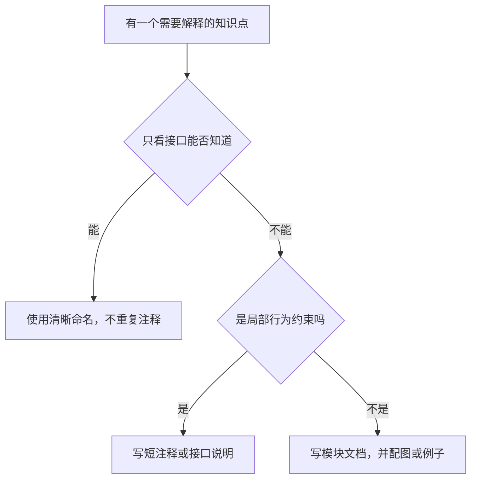

# 文档与注释约定

这是一个学习项目。读者应能理解“请求怎样流动、接口为什么存在、失败后会发生什么”，而不只是知道某个文件叫哪一个名字。

## 1. 语言和写法

- 架构、教程、模块说明、错误解释和必要注释优先使用中文。
- 类型、变量、函数、目录使用清晰英文名称，便于对应 Pi/Electron 文档。
- 第一次出现英文术语时附中文含义，必要时链接到[术语表](../learning/02-glossary.md)。
- 示例尽量围绕同一件事：读取 README、修改一个文件、运行测试。
- 使用完整句子说明职责和约束，避免只写“这里解耦”“采用 SOLID”等无法追踪到行为的结论。
- 明确区分已实现、设计目标、未来演进，不能把参考项目的能力写成本项目已完成。

## 2. 模块说明的最小结构

模块逐步实现时补充短 README，包含：

1. **负责什么：** 输入、输出、边界。
2. **依赖谁：** 使用哪个接口，禁止依赖哪些具体实现。
3. **怎样参与任务：** 一张流程图或时序图。
4. **关键约束：** 取消、审批、参数与数据所有权。
5. **怎样验证：** 运行步骤、预期输出、异常例子。
6. **当前限制：** 例如不恢复原生会话、不支持交互式命令。

不要提前创建空 README；实现某模块时让说明与实际行为一起产生。

## 3. 图用来回答具体问题

| 想解释的问题 | 使用的图 |
| --- | --- |
| 模块在哪里运行、怎样连接 | 架构图 flowchart + subgraph |
| 谁调用谁、返回的顺序 | sequenceDiagram |
| 批准、拒绝、取消怎样分支 | flowchart |
| Run 何时变成什么状态 | stateDiagram-v2 |
| Session 与 Run/工具的关系 | erDiagram |

每张图控制在一个主题内，标签使用读者能懂的职责。图前说清它要回答的问题，图后说明简化掉的转发或例外。箭头写明请求、事件、结果或依赖，避免读者猜测。

下面的图说明：注释和文档应该根据问题放在不同地方。



## 4. 注释写约束，教程写原理

注释不追求数量。下面这些情况值得解释：调用者必须遵守的约束、异步生命周期、错误后的行为、数据来源、外部系统限制。

例如 Agent 接口需要说明结束和取消的含义；仅靠 `Promise<void>` 看不出这些约束：

```typescript
interface AgentSession {
  /** 本次模型与工具循环全部结束后才 resolve；失败 reject；用户取消不算失败。 */
  prompt(input: string): Promise<void>;

  /** 等待运行停止，不只发出中止通知；相关命令由 Core 同时取消。 */
  abort(): Promise<void>;
}
```

例如审批可能在 UI 取消后迟到，代码附近可以说明生命周期约束：

```typescript
// 审批可能晚于取消到达；授权只能用于仍活动的 Run。
const activeRun = runManager.requireActiveRun(request.runId);
```

不要写这种逐行复述：

```typescript
// 获取 Run
const run = runManager.get(runId);

// 返回结果
return result;
```

“什么是 Agent Loop”“为什么拆 Main/Renderer”属于教程与架构说明。局部注释链接到文档即可，不把长篇原理复制到每个函数。

## 5. 代码和图同步的检查

接口改名、状态变化或新增审批分支时，检查四件事：

- 类型定义与代码示例是否一致。
- 图里的职责归属是否仍成立。
- 成功、拒绝、取消和失败路径是否都有说明。
- 示例能否在不调用付费模型的情况下，用 Mock/临时工作区观察。

文档示例若只是概念片段，注明这一点；完整可运行示例要记录依赖与运行步骤。Mermaid 语法检查只证明图可解析，不能代替阅读图与实现验证。

## 6. 开发阶段的学习记录

每完成一个阶段，记录一个成功例子和一个失败例子。说明真实现象、原因和相关模块，不编造截图、日志或“测试通过”结论。

例如执行命令失败，不只写“修复了命令问题”，应写“命令以非零退出码结束，CommandService 返回退出码，ToolService 映射为工具错误，Agent 收到错误后决定下一步”。这样能把用户看到的现象连接到架构中的数据流。
