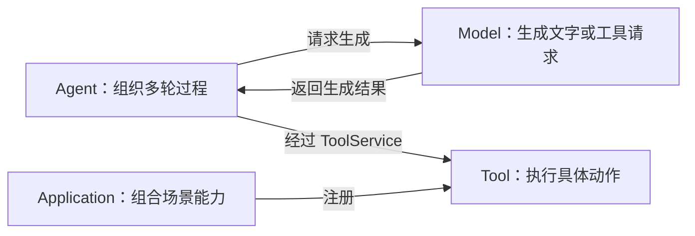

# 术语表

| 术语 | 简单解释 | 在本项目中的边界 |
| --- | --- | --- |
| Agent | 会组织多轮模型请求并决定何时调用工具的运行时 | Pi 是首个 Agent 实现，Core 通过 Adapter 使用它 |
| Agent Loop | “请求模型 → 处理回复 → 执行工具 → 把结果交回模型”的循环 | 由 Agent Adapter/Pi 拥有，不在 UI 或 RunManager 中重复实现 |
| Adapter | 把通用接口翻译成具体实现的适配器 | 负责 Pi 的 SDK 类型、事件和模型连接，不负责审批规则 |
| Application Module | 一个工作场景的组合包 | Coding 组合编程工具、提示词和视图，不拥有 Core |
| Artifact | 可单独查看的文件或输出 | Diff、长命令输出等，通过引用而不是无限塞进消息 |
| Approval | 用户对一次具体高风险 ToolCall 的决定 | 允许一次、拒绝一次或取消，不能改写原请求 |
| Core | 应用的协调逻辑和稳定接口 | 管理 Session/Run/审批，不直接 import Pi/Electron |
| CredentialRef | 指向受保护凭据的非敏感 ID | settings 只保存引用，Renderer 不拿明文 |
| Diff | 两个文件版本之间的变化 | 要区分运行前用户已有修改和本次修改 |
| Endpoint | 模型服务的网络地址 | 配置地址不等于已经兼容某种协议 |
| Handler | 工具的实际执行函数 | 通过 ToolService 才能被 Agent 调用 |
| IPC | Electron Main 与 Renderer 的进程通信 | Preload 只暴露有限、校验过的方法 |
| Model | 生成文本和工具调用的模型服务 | 不决定会话怎样调度工具；由 Provider 适配 |
| Model Profile | 应用保存的一组模型连接配置 | 有 apiStyle、Endpoint、modelId 和 credentialRef |
| Preload | Electron 的受限桥接脚本 | 不暴露通用 Node API |
| Provider | 按某种模型 API 协议发送和接收请求的实现 | Pi AI 首版负责具体协议映射 |
| Registry | 保存定义和实现的注册表 | Agent、Tool、Model、Application 各自有注册入口 |
| Repository | 保存和读取领域数据的接口 | 首版用 JSON 实现，未来可换 SQLite |
| Run | 处理一次用户输入的过程 | 内部可以包含多轮模型请求和多个 ToolCall |
| Session | 一个持续对话 | 固定工作区、应用、Agent 和模型配置 |
| Tool | Agent 可请求的具体能力 | 由 ToolService 校验、审批、执行并返回结果 |
| ToolCall | 一次具体工具请求 | 只属于一个 Run，审批绑定它的参数和身份 |
| ToolService | 工具调用的唯一门口 | Registry 找工具，Service 决定是否可执行 |
| Workspace | 用户选定的本地项目目录 | 文件操作以它为根，不信任 UI 当前标签 |
| Worker | 后续可加入的独立运行进程 | 学习版不实现；Main 内模块不是 Worker |

## 最容易混淆的三组关系

- **模型不是 Agent：** 模型一次只返回结果，Agent 负责把工具结果放回上下文并决定是否继续。
- **注册不是批准：** Registry 只是让系统知道工具，审批决定这一次能不能执行。
- **历史不是恢复：** 保存 UI 消息可以浏览过去；无原生 checkpoint 不能宣称恢复了 Agent 的内部上下文。
