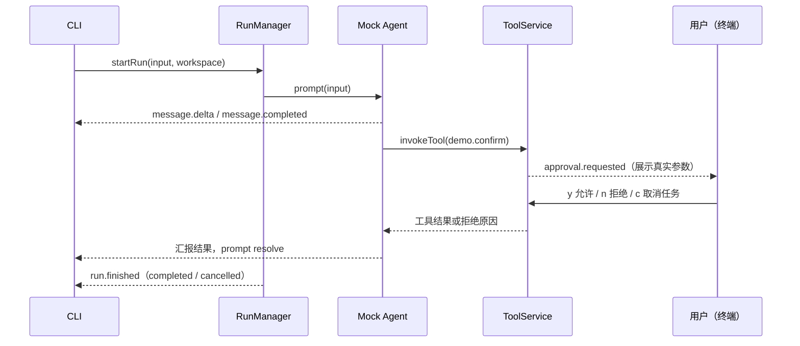

# 阶段 1：先看清楚一条工具调用（CLI + Mock Agent）

- 日期：2026-10-14。
- 状态：已实现并通过验证；对应[学习路线](../learning/01-roadmap.md)阶段 1。

## 目标

在无 Electron、无 API Key 的条件下，观察一次完整的"输入 → Agent → 工具审批 → 执行 → Run 结束"流程，理解 Session/Run/ToolCall 的关系，以及"模型请求工具"和"应用执行工具"是不同步骤。

## 数据流



循环由 Mock Agent 拥有；RunManager 只负责生命周期、订阅、取消和结算，没有第二个"模型—工具"循环。

## 涉及模块

| 路径 | 职责 |
| --- | --- |
| `src/shared/contracts/` | tool / agent / run 三组公共类型，不 import 任何实现 |
| `src/main/tools/registry.ts` | 工具登记与查找；重复 ID 报错；不做安全检查 |
| `src/main/tools/service.ts` | 唯一执行门口：Schema 校验（Ajv）、风险审批、执行 |
| `src/main/tools/approval.ts` | 审批请求/决定/入口契约 |
| `src/main/tools/demo.ts` | demo.echo（read，直接执行）、demo.confirm（write，刻意用于演练审批，无真实副作用） |
| `src/main/applications/coding/read-file.ts` | coding.read_file：realpath + 相对路径校验，文件必须已存在 |
| `src/main/agents/mock.ts` | 脚本化 Agent：发文字 → 调 demo.confirm → 汇报；取消在各检查点生效 |
| `src/main/core/run-manager.ts` | 单活动 Run、事件汇总（waiting_approval 状态）、取消传播、终态结算 |
| `src/cli/index.ts` | 装配全部模块；终端审批 y/n/c，EOF 视为拒绝 |

## 运行步骤

```text
pnpm install
pnpm typecheck
pnpm test          # 15 个测试
pnpm cli "任意任务文字"
```

## 输入输出例子（真实运行记录，2026-10-14）

允许路径（输入 y）：

```text
=== Run 开始 ===
收到任务，我将调用演示工具处理。
[工具] 调用 demo.confirm ...
[审批] 工具 demo.confirm 请求执行：
  参数：{"text":"帮我检查配置项"}
  允许一次？(y=允许 / n=拒绝 / c=取消任务) [工具] demo.confirm 完成
演示结果：已获批准并执行，原文：帮我检查配置项
=== Run 结束：completed ===
```

拒绝路径（输入 n）：工具显示"未成功"，Agent 收到"用户拒绝了工具 demo.confirm 的本次调用"，Run 仍以 completed 结束（Run 完成不等于任务成功；被拒也是一次正常结算）。

## 验收证据

- `pnpm test`：15/15 通过，覆盖允许、拒绝、取消后批准不执行、未知工具、参数校验失败、重复注册报错、活动 Run 互斥、waiting_approval 事件顺序、工作区越界拒绝。
- `pnpm typecheck`：tsc 严格模式无错误。
- 上述 CLI 真实运行记录。
- 阶段问题回答：ToolRegistry 本身不是安全检查（它只回答"有没有这个工具"，ToolService 才回答"这次能不能执行"）；Core 不直接调用 Pi（Core 依赖 AgentAdapter 接口，Pi 的类型转换收敛在 agents/pi，阶段 2 验证）。

## 当前限制

- Mock 只调用 demo.confirm；coding.read_file 已注册并有单元测试，但 Mock 流程不使用它。
- RunStatus 尚未包含 cancelling / interrupted；重启恢复与中断标记属于阶段 5。
- 无事件持久化与重放；界面重载中断任务的设计尚未有界面可验证。
- 终端审批在 stdin 管道下表现为一次性应答；交互式取消（c）需真实终端。

## 常见错误

- Node 版本低于 22：`engines` 字段会拒绝安装。
- 直接 `node src/cli/index.ts`：不生效，需经 `pnpm cli`（tsx 加载 TypeScript）。
- 修改审批展示参数：界面只返回 allow/deny，改参数不会改变实际执行内容（ToolService 保存的是原始请求）。
